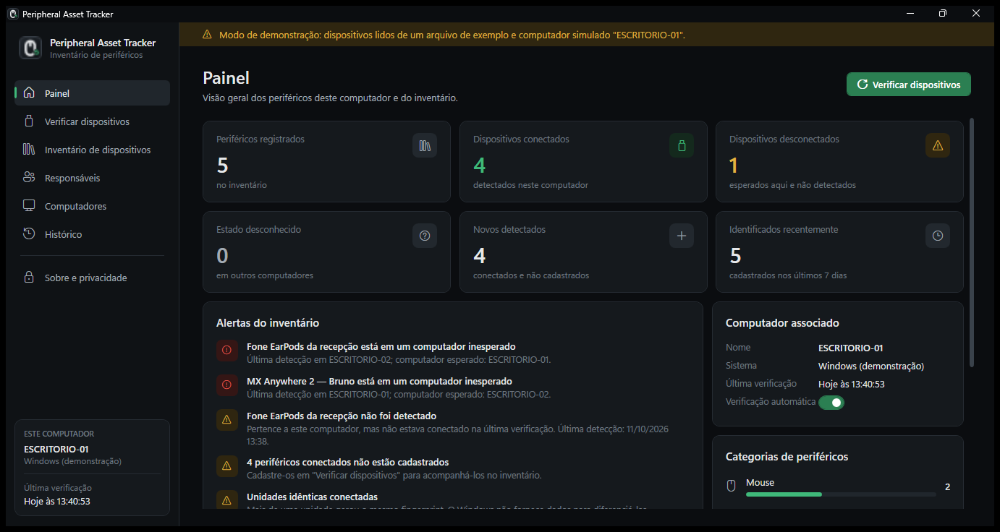
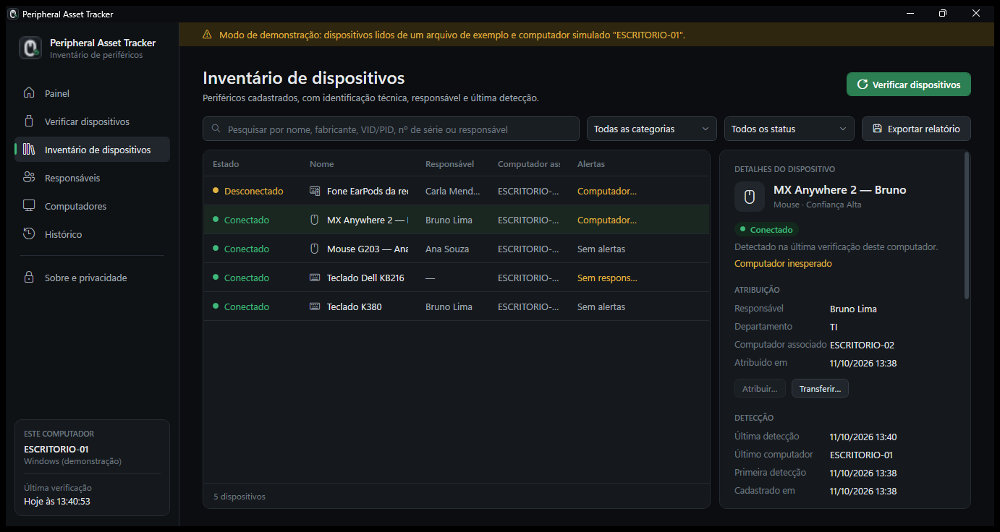
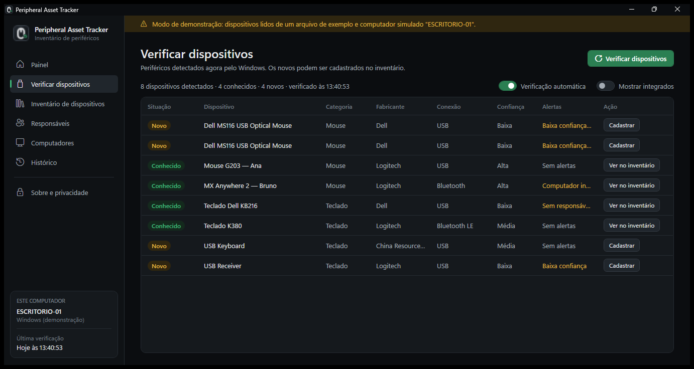

# Peripheral Asset Tracker

Aplicativo para Windows 10 e 11 que faz o **inventário local de periféricos** (mouses, teclados e outros dispositivos HID). Ele mostra quais estão conectados, quem é o responsável por cada um e em qual computador cada um deveria estar. Inclui também uma ferramenta de linha de comando (`pat`) para automação.

> **Escopo:** inventário de HARDWARE e registro de movimentações administrativas. O aplicativo **não** captura teclas, movimento do mouse, área de transferência, telas, arquivos ou qualquer atividade pessoal. Veja [Privacidade](#privacidade).



## Download

**[Baixar Peripheral-Asset-Tracker-v1.0.0.exe](https://github.com/kelvinsg218/peripheral-asset-tracker/releases/download/v1.0.0/Peripheral-Asset-Tracker-v1.0.0.exe)** (Windows 10/11 de 64 bits, cerca de 60 MB). Todas as versões ficam em [Releases](https://github.com/kelvinsg218/peripheral-asset-tracker/releases).

- Arquivo único e portátil: não tem instalador e não exige .NET, Python ou Node.js.
- Não precisa de permissão de administrador.
- O SHA-256 do executável é publicado na página da Release.

> **Aviso do SmartScreen:** o executável não tem assinatura digital de código. Na primeira execução, o Windows pode exibir "O Windows protegeu o computador". Confira o SHA-256 e clique em **Mais informações → Executar assim mesmo**.

## Como usar

1. Dê dois cliques em `Peripheral-Asset-Tracker-v1.0.0.exe`. Na primeira vez, o aplicativo cria o banco local e verifica os periféricos conectados.
2. **Verificar dispositivos**: lista o que o Windows detecta agora. Os dispositivos marcados como **Novo** podem ser cadastrados com nome, categoria, responsável e computador esperado.
3. **Inventário de dispositivos**: pesquise por nome, fabricante, VID/PID, número de série ou responsável e filtre por categoria e status. Selecione um item para ver a identificação técnica, a atribuição e o histórico. **Atribuir…** e **Transferir…** registram mudanças; **Exportar relatório** gera um CSV para o Excel.
4. **Painel**: totais, conectados, desconectados, novos, categorias e alertas.
5. Para encerrar, feche a janela. O aplicativo não fica em segundo plano.

O estado de presença é sempre relativo ao computador em uso:

| Estado | Significado |
|---|---|
| Conectado | detectado na última verificação deste computador |
| Desconectado | associado a este computador, mas ausente na última verificação |
| Desconhecido | associado a outro computador, ou ainda não verificado: este computador não consegue confirmar |

Com a **Verificação automática** ligada, o aplicativo verifica de novo quando o Windows avisa que um dispositivo foi conectado ou removido, mas somente enquanto a janela está aberta.

| Inventário de dispositivos | Verificar dispositivos |
|---|---|
|  |  |

> As capturas foram feitas no modo de demonstração, com dados fictícios (`--fixture` e `--host`).

### Onde ficam os dados

Os dados ficam em `%LOCALAPPDATA%\PeripheralAssetTracker\`: o banco SQLite em `data\peripheral-assets.db` e os registros técnicos em `logs\`. Nada é enviado pela internet. Para usar outra pasta (por exemplo, o mesmo banco em vários computadores, a partir de um pendrive), use a variável de ambiente `PAT_DATA_DIR` ou a opção `--data-dir <pasta>`.

## Gerar o executável

Pré-requisito: .NET SDK 9.

```powershell
powershell -ExecutionPolicy Bypass -File .\build.ps1
```

O script executa os testes e publica o aplicativo como um único `.exe` self-contained (`win-x64`, com compressão). O resultado fica em `artifacts\release\Peripheral-Asset-Tracker-v<versão>.exe`, junto com o arquivo `.sha256`. A versão vem de `<Version>` em `Directory.Build.props`, e a pasta `artifacts/` é ignorada pelo Git.

Durante o desenvolvimento:

```powershell
dotnet run --project src/PeripheralAssetTracker.Desktop
# modo de demonstração, sem hardware real e sem tocar nos seus dados
dotnet run --project src/PeripheralAssetTracker.Desktop -- --data-dir .\temp\demo --host ESCRITORIO-01 --fixture tests\PeripheralAssetTracker.Tests\Fixtures\synthetic-office-desk.json
```

---

# Documentação técnica

## Sumário

- [Problema e objetivo](#problema-e-objetivo)
- [Implementado vs. Planejado](#implementado-vs-planejado)
- [Como funciona](#como-funciona)
- [Arquitetura](#arquitetura)
- [Tecnologias](#tecnologias)
- [Device Discovery](#device-discovery)
- [Limitações HID e deduplicação](#limitações-hid-e-deduplicação)
- [Device Fingerprint (SHA-256)](#device-fingerprint-sha-256)
- [FingerprintConfidence: HIGH / MEDIUM / LOW](#fingerprintconfidence-high--medium--low)
- [Modelo de domínio](#modelo-de-domínio)
- [Expected vs Observed](#expected-vs-observed)
- [Status do dispositivo](#status-do-dispositivo)
- [Compilação a partir do código](#compilação-a-partir-do-código)
- [Execução e CLI](#execução-e-cli)
- [SQLite e EF Core Migrations](#sqlite-e-ef-core-migrations)
- [Cadastro, Assignment e Transfer](#cadastro-assignment-e-transfer)
- [Observations (estratégia anti-spam)](#observations-estratégia-anti-spam)
- [Movement History](#movement-history)
- [Exportação CSV](#exportação-csv)
- [Logs e tratamento de erros](#logs-e-tratamento-de-erros)
- [Testes](#testes)
- [Privacidade](#privacidade)
- [Limitações conhecidas](#limitações-conhecidas)
- [Roadmap](#roadmap)

---

## Problema e objetivo

Periféricos circulam: são entregues a funcionários, trocados de máquina, emprestados e aparecem em computadores diferentes daqueles a que estavam associados. O setor de TI precisa responder:

- Qual dispositivo está conectado nesta máquina? Já está cadastrado?
- Qual o fabricante/modelo e o identificador interno?
- Quem é o responsável? Em qual computador ele **deveria** estar e em qual foi **encontrado**?
- Quando foi visto pela última vez? Já esteve com outra pessoa ou em outro computador?
- Há dispositivos sem responsável ou em computadores inesperados?
- **A identificação desse dispositivo é realmente confiável?**

Mouses e teclados **não** possuem um "Hash ID" físico universal. O Peripheral Asset Tracker cria o seu próprio **Device Fingerprint** a partir das propriedades que o Windows expõe e é explícito sobre o quanto esse fingerprint consegue (ou não) individualizar uma unidade física.

---

## Implementado vs. Planejado

### ✅ IMPLEMENTADO (v1)

| Área | O que existe |
|---|---|
| Descoberta | `WindowsDeviceDiscoveryService` via CfgMgr32 (API PnP do Windows), somente leitura |
| Deduplicação HID | Agrupamento de interfaces/coleções HID em dispositivos físicos (nó físico + ContainerId) |
| Fingerprint | Normalização explícita + forma canônica versionada (`v1`) + SHA-256 |
| Confiança | `FingerprintConfidence` HIGH/MEDIUM/LOW com a base textual de cada decisão |
| Persistência | SQLite + EF Core 9 + Migrations, FKs, CHECKs, índices, `UNIQUE` em Fingerprint |
| Domínio | Device, Computer, ResponsiblePerson, Assignment, DeviceObservation, DeviceMovement |
| Regras | Uma única Assignment ativa (domínio **e** índice único filtrado no banco) |
| Expected vs Observed | Alerta `UNEXPECTED_COMPUTER` sem alterar a Assignment |
| Transfer | Transação com rollback em qualquer falha |
| Observations | Coalescência anti-spam sem perda de mudanças de local |
| Aplicativo desktop | WPF, tema escuro, pt-BR: painel, verificação, inventário com pesquisa, filtros, detalhes e histórico, atribuição/transferência, responsáveis, computadores, exportação CSV, verificação automática ao conectar/desconectar |
| Distribuição | `.exe` único self-contained (win-x64), sem instalação e sem privilégios de administrador |
| CLI | Menu interativo (PT-BR) + comandos diretos para automação |
| Pesquisa e filtros | Case/acento-insensitive; filtros por tipo, responsável, computador, sem responsável, LOW, unexpected |
| Histórico | Linha do tempo: cadastro, atribuições, transferências, observações (com alerta histórico) |
| CSV | `reports/inventory_YYYY-MM-DD_HHMMSS.csv`, UTF-8 com BOM, delimitador compatível com Excel |
| Logs | Arquivo diário em `logs/`, sem stack trace no console |
| Simulação | `--fixture` (snapshot PnP) e `--host` (hostname simulado) para validar sem hardware |
| Testes | 189 testes automatizados (xUnit), sem dependência de hardware real |

### 🗺️ PLANEJADO (não existe nesta versão)

API central, PostgreSQL, Active Directory, agente distribuído, inventário consolidado de várias máquinas, alertas fora do aplicativo (e-mail/notificações), relatórios administrativos e sincronização centralizada. Veja [Roadmap](#roadmap).

---

## Como funciona

```
Windows PnP (CfgMgr32)  ──►  nós PnP brutos (instância, pai, classe, hardware IDs, ContainerId...)
        │
        ▼
HidDeviceGrouper  ──►  agrupa interfaces/coleções HID em DISPOSITIVOS FÍSICOS
        │
        ▼
DeviceFingerprintService  ──►  normaliza → escolhe os melhores identificadores → forma canônica → SHA-256
        │                                                                  + FingerprintConfidence
        ▼
ScanService  ──►  compara com o inventário (SQLite) → registra Observation → avalia status
        │
        ▼
Desktop / CLI  ──►  mostram, cadastram, atribuem, transferem, pesquisam, exportam
```

Na inicialização (o aplicativo desktop usa `%LOCALAPPDATA%\PeripheralAssetTracker` como raiz; a CLI usa a pasta atual): (1) cria `data/`, `logs/`, `reports/`; (2) abre o SQLite; (3) aplica migrations pendentes; (4) obtém o hostname; (5) obtém a versão do Windows; (6) cadastra/atualiza o `Computer` atual; (7) abre o menu ou executa o comando.

---

## Arquitetura

```
PeripheralAssetTracker.sln
├── src/
│   ├── PeripheralAssetTracker.Domain/          entidades, enums, invariantes, avaliação de status, política de observações
│   ├── PeripheralAssetTracker.Application/     casos de uso, portas (interfaces), normalização, fingerprint, CSV, DTOs
│   ├── PeripheralAssetTracker.Infrastructure/  SQLite/EF Core, migrations, CfgMgr32 (PnP), agrupamento HID, registro do
│   │                                           Windows, arquivos de relatório, logger em arquivo
│   ├── PeripheralAssetTracker.Cli/             menu, comandos, entrada/saída e formatação (executável `pat`)
│   └── PeripheralAssetTracker.Desktop/         aplicativo WPF (pt-BR): telas, view models, tema escuro, ícone
│                                               (executável `PeripheralAssetTracker.exe`)
└── tests/
    └── PeripheralAssetTracker.Tests/           domínio, fingerprint, agrupamento HID, persistência, casos de uso, CSV, CLI,
                                                apresentação do desktop
```

Dependências: `Cli / Desktop → Infrastructure → Application → Domain`. Nenhum dos dois executáveis contém regra de negócio: ambos usam os mesmos serviços da camada Application (`ScanService`, `DeviceRegistrationService`, `AssignmentService`, `InventoryQueryService`, `HistoryService`, `InventoryExportService`...).

Decisão pragmática: a camada Application depende da API **provider-agnostic** do EF Core (`DbSet`, transações) através de `IAssetTrackerDbContext`, em vez de uma camada de repositórios. Detalhes do SQLite ficam em Infrastructure.

---

## Tecnologias

| Item | Versão |
|---|---|
| C# / .NET | **.NET 9** (SDK 9.0.200, runtime 9.0.2, win-x64) |
| Banco | SQLite (Microsoft.Data.Sqlite) |
| ORM | Entity Framework Core 9.0.20 + Migrations (`dotnet-ef` como ferramenta local) |
| DI/Logging | Microsoft.Extensions.DependencyInjection / Logging 9.0.20 |
| Interface desktop | WPF (`net9.0-windows`), sem bibliotecas de terceiros |
| Testes | xUnit 2.9.3 |

> **Sobre a versão do .NET:** a especificação pedia .NET 8 LTS "ou LTS compatível disponível". A máquina de desenvolvimento tinha **apenas** o SDK/runtime do .NET 9 (sem .NET 8 nem .NET 10). O target está centralizado em `Directory.Build.props` e as versões dos pacotes em `Directory.Packages.props`. Para migrar para o **.NET 10 LTS** (recomendado, pois o suporte do .NET 9 termina em novembro de 2026), altere `TargetFramework` para `net10.0` e os pacotes EF Core/Extensions para `10.0.x`.

Nenhum framework adicional (sem Serilog, sem System.CommandLine, sem Moq): o logger em arquivo e o parser de argumentos são pequenos e internos.

---

## Device Discovery

`IDeviceDiscoveryService` (Application) tem três implementações (Infrastructure):

- **`WindowsDeviceDiscoveryService`**: lê os nós PnP **presentes** pela API **CfgMgr32** (`CM_Get_Device_ID_List`, `CM_Locate_DevNode`, `CM_Get_DevNode_Property`), a mesma usada pelo Gerenciador de Dispositivos e por `Get-PnpDevice`. **Não usa WMIC.exe.** É somente leitura: não abre os dispositivos, não lê relatórios de entrada e não altera nada.
- **`SnapshotDeviceDiscoveryService`**: reproduz um snapshot JSON de nós PnP pela **mesma** lógica de agrupamento (`--fixture`).
- **`UnsupportedPlatformDiscoveryService`**: fora do Windows o inventário funciona, mas o scan informa que não é suportado.

Propriedades lidas de cada nó: Device Instance ID (== PNP Device ID), pai, classe, enumerador, nome amigável, descrição, fabricante (do driver), descrição reportada pelo barramento (string de produto USB), Hardware IDs, ContainerId e serviço.

Diagnóstico: `pat discover --all` mostra cada dispositivo físico com todas as entradas agrupadas, Hardware IDs e a forma canônica do fingerprint; `pat discover --dump arquivo.json` salva o snapshot bruto.

---

## Limitações HID e deduplicação

**Uma entrada do Windows ≠ um dispositivo físico.** Exemplo real observado (fone USB com controles):

```
USB\VID_05AC&PID_110B\<serial>                ← dispositivo físico USB (composto)
├─ USB\VID_05AC&PID_110B&MI_00\...            ← interface de áudio
├─ USB\VID_05AC&PID_110B&MI_03\...            ← interface HID
│   └─ HID\VID_05AC&PID_110B&MI_03\...        ← coleção "consumer control"
└─ USB\VID_05AC&PID_110B&MI_04\...            ← interface HID
    └─ HID\VID_05AC&PID_110B&MI_04\...        ← coleção definida pelo fabricante
```

Estratégia (`HidDeviceGrouper`, lógica pura e testada):

1. **Funções** = coleções HID de topo (enumerador `HID`) e qualquer nó da classe `Mouse`/`Keyboard` (inclui PS/2).
2. A partir de cada função, sobe pelos pais enquanto o nó for coleção HID ou **interface USB** (`MI_xx`). O ponto de parada é o **nó físico** (dispositivo USB, Bluetooth, ACPI/I2C).
3. Agrupa pelo **ContainerId** do nó físico (a noção do próprio Windows de "uma caixa física"). O ContainerId especial `{00000000-0000-0000-FFFF-FFFFFFFFFFFF}` significa "parte do computador" → dispositivo **integrado** (oculto por padrão; `scan --all` exibe).
4. **Tipo** = função da menor interface/coleção que seja mouse ou teclado. Se houver ambos (mouses gamer com teclas programáveis, receptores sem fio combinados), é emitida uma **nota** pedindo que o técnico confirme o tipo no cadastro. O tipo **não** é adivinhado silenciosamente.
5. Dispositivos virtuais (RDP, Hyper-V, `ROOT`, `SWD`, `TERMINPUT_BUS`) são ignorados e contabilizados.
6. Nome: string de produto USB (não localizada) quando existe; senão, o nome do Windows (localizado).
7. Fabricante: tabela de VIDs conhecidos. O campo "Manufacturer" do Windows é o **fornecedor do driver** (ex.: "(Dispositivos padrão do sistema)", "Microsoft"), não o fabricante do hardware, e por isso é descartado quando genérico. VID desconhecido → **Indisponível**.

Casos em que **não** há certeza, documentados em vez de "resolvidos" artificialmente:

- **Receptores sem fio** (Unifying/Bolt/nano): a identidade técnica é a do **receptor**, não do mouse/teclado pareado.
- **Duas unidades idênticas sem serial**: continuam como dois dispositivos no scan, mas geram o **mesmo** fingerprint → alerta `AMBIGUOUS_FINGERPRINT`, e apenas um pode ser cadastrado.
- **Teclado via ACPI/PS2**: pode ser o teclado do notebook ou um teclado PS/2 externo; o Windows os coloca no container do computador.

---

## Device Fingerprint (SHA-256)

`DeviceFingerprintService`: **propriedades → normalização → seleção dos melhores identificadores → forma canônica determinística → SHA-256 (hex, 64 caracteres)**. Nunca usa `GetHashCode()`.

Forma canônica versionada, por exemplo:

```
v1|bus=USB|vid=046D|pid=C084|serial=ABC123         (HIGH)
v1|bus=USB|vid=413C|pid=2113                       (LOW)
v1|bus=BLUETOOTH|vid=046D|pid=B016|btaddr=E1C2D3A4B5C6
v1|bus=INTERNAL|hwid=ACPI\VEN_FUJ&DEV_7401
```

Seleção (a primeira que se aplica):

1. Endereço Bluetooth → HIGH (clássico) / MEDIUM (LE)
2. Serial USB → HIGH, ou MEDIUM se o serial parecer genérico
3. VID + PID → LOW
4. Hardware ID mais específico (sem `REV_xxxx`) → LOW
5. Nome/fabricante normalizados → LOW (último recurso)

**Deliberadamente fora do fingerprint:**

- revisão de firmware (muda com atualização);
- nomes e fabricante do Windows (são **localizados**: pt-BR e en-US gerariam fingerprints diferentes);
- caminho de porta USB / instance ID gerado (muda ao trocar de porta ou de computador, o que impediria rastrear o dispositivo entre máquinas).

**Normalização** (`DeviceIdentifierNormalizer`, com testes):

| Campo | Regra |
|---|---|
| VID/PID | aceita `046d`, `0x046D`, `VID_046D`, `PID&C084`, espaços → 4 dígitos hex maiúsculos |
| Serial | sem espaços, maiúsculo; placeholders (`N/A`, `None`, `Default string`...) → ausente |
| PNP Device ID / Hardware IDs | maiúsculo, `/`→`\`, sem espaços em volta de separadores; Hardware IDs deduplicados mantendo a ordem |
| Manufacturer | texto limpo; rótulos genéricos de driver → ausente |
| DeviceName | espaços colapsados; comparação case-insensitive |
| Vazios | `null`, `""`, só espaços → ausente |

Caracteres estruturais (`|`, `=`) são escapados, então entradas diferentes não podem forjar a mesma forma canônica. Um teste de regressão fixa o valor v1.

---

## FingerprintConfidence: HIGH / MEDIUM / LOW

| Nível | Critério na v1 | Significado |
|---|---|---|
| **HIGH** | serial USB plausível + VID/PID; ou endereço Bluetooth clássico (BD_ADDR) | forte evidência de uma unidade física específica |
| **MEDIUM** | serial com padrão genérico (curto, caractere repetido como `0000000000`, sequência como `123456789`); endereço Bluetooth LE (pode ser endereço aleatório estático); serial sem VID/PID | combinação relativamente forte, sem garantia de individualização |
| **LOW** | apenas VID/PID, Hardware ID ou nome | depende de propriedades **compartilhadas por todas as unidades do modelo** |

Regra de honestidade: **VID/PID sozinho nunca vira identidade física.** Um dispositivo LOW exibe `LOW_CONFIDENCE`, e, ao cadastrar um fingerprint LOW já existente, a mensagem explica que pode ser outra unidade do mesmo modelo.

---

## Modelo de domínio

| Entidade | Campos principais | Observações |
|---|---|---|
| **Device** | Id, Fingerprint (**UNIQUE**), FingerprintConfidence, FingerprintBasis, DeviceType, DeviceName, Manufacturer, VendorId, ProductId, SerialNumber, BluetoothAddress, BusType, PnpDeviceId, FirstSeenAt, LastSeenAt, LastSeenComputerId, CreatedAt, UpdatedAt | Raiz do agregado; garante uma Assignment ativa |
| **Computer** | Id, Hostname (**UNIQUE**, maiúsculo), WindowsVersion, FirstSeenAt, LastSeenAt, CreatedAt | FirstSeen/LastSeen ficam nulos em computadores informados manualmente onde o app nunca rodou ("Nunca executado") |
| **ResponsiblePerson** | Id, Name, Department?, CreatedAt, UpdatedAt | **Não** é usuário autenticado |
| **Assignment** | Id, DeviceId, ResponsiblePersonId?, ExpectedComputerId?, AssignedAt, EndedAt?, IsActive | Atribuição **oficial**; exige responsável e/ou computador esperado |
| **DeviceObservation** | Id, DeviceId, ComputerId, ObservedAt, LastObservedAt, ScanCount | Onde o dispositivo foi **efetivamente** detectado |
| **DeviceMovement** | Id, DeviceId, MovementType (Assignment/Transfer), From/ToResponsiblePersonId, From/ToComputerId, ChangedAt, Reason | Mudança oficial registrada pelo técnico |

`DeviceType`: `Mouse`, `Keyboard`, `Other`. Todas as datas são armazenadas em UTC e exibidas no horário local.

---

## Expected vs Observed

- **EXPECTED**: computador da Assignment ativa (onde o dispositivo **deveria** estar).
- **OBSERVED**: computador onde o scan o encontrou.

Se ambos forem conhecidos e diferentes:

```
Status:  UNEXPECTED_COMPUTER
ATENÇÃO: DEVICE FOUND ON UNEXPECTED COMPUTER (a atribuição NÃO foi alterada).
```

A Assignment **nunca** é alterada automaticamente, porque o equipamento pode estar ali temporariamente. Só uma **transferência** feita pelo técnico muda a situação oficial. No histórico, cada observação é comparada com a Assignment que estava ativa **naquele momento**, então alertas passados continuam visíveis depois de uma transferência.

---

## Status do dispositivo

Os status são um **conjunto de flags** (`DeviceConditions`): uma condição nunca sobrescreve outra.

| Código | Quando |
|---|---|
| `OK` | nenhuma condição |
| `NOT_REGISTERED` | detectado, mas não cadastrado |
| `UNASSIGNED` | sem Assignment ativa ou sem responsável |
| `UNEXPECTED_COMPUTER` | observado ≠ esperado |
| `LOW_CONFIDENCE` | fingerprint LOW |
| `AMBIGUOUS_FINGERPRINT` | mais de uma unidade conectada gerou o mesmo fingerprint no scan |

Exemplos: `UNASSIGNED + LOW_CONFIDENCE`; `UNEXPECTED_COMPUTER + LOW_CONFIDENCE + AMBIGUOUS_FINGERPRINT`.

---

## Compilação a partir do código

Pré-requisitos: Windows 10/11 e .NET SDK 9 (ou superior, com retarget; veja [Tecnologias](#tecnologias)).

```powershell
git clone <url>/peripheral-asset-tracker.git
cd peripheral-asset-tracker
dotnet restore
dotnet build
dotnet test
```

Não há configuração manual: na primeira execução o banco é criado e as migrations são aplicadas automaticamente. Não é necessário executar como administrador.

## Execução e CLI

```powershell
# menu interativo (dados em .\data, .\logs, .\reports)
dotnet run --project src/PeripheralAssetTracker.Cli

# ou o executável compilado
.\src\PeripheralAssetTracker.Cli\bin\Debug\net9.0\pat.exe
```

Menu:

```
========================================================
PERIPHERAL ASSET TRACKER
========================================================
Computador: TI-04

[1] Verificar dispositivos conectados
[2] Dispositivos cadastrados
[3] Pesquisar
[4] Atribuir dispositivo
[5] Transferir dispositivo
[6] Computadores
[7] Responsáveis
[8] Histórico de movimentações
[9] Exportar inventário (CSV)
[0] Sair
```

Comandos diretos (automação):

```powershell
pat scan [--all] [--details]
pat register <nº do scan|prefixo do fingerprint> [--type mouse|keyboard|other] [--name "Nome"] [--person <id>] [--computer <hostname> | --expected-current]
pat devices [--type T] [--person <id>] [--computer <hostname>] [--unassigned] [--low] [--unexpected]
pat device <#id|fingerprint>
pat search <termo>
pat people [list | add <nome> [--department S] | search <termo> | devices <id>]
pat assign <#id|fingerprint> [--person <id>] [--computer <hostname>]
pat transfer <#id|fingerprint> [--person <id>] [--computer <hostname>] --reason "..." [--yes]
pat computers
pat history [<#id|fingerprint>]
pat export [--delimiter ;|,|tab]
pat discover [--all] [--dump arquivo.json]
pat help
```

Opções globais:

| Opção | Uso |
|---|---|
| `--data-dir <pasta>` | raiz de `data/`, `logs/`, `reports/` (padrão: pasta atual ou variável `PAT_DATA_DIR`) |
| `--fixture <snapshot.json>` | **simulação**: usa um snapshot PnP no lugar do hardware real |
| `--host <nome>` | **simulação**: finge ser outro computador (para validar Expected vs Observed) |

Exemplo de simulação completa, sem hardware:

```powershell
$fx = "tests\PeripheralAssetTracker.Tests\Fixtures\synthetic-office-desk.json"
pat --data-dir .\temp\demo --fixture $fx --host TI-04 people add Kelvin --department TI
pat --data-dir .\temp\demo --fixture $fx --host TI-04 register 3 --person 1 --expected-current
pat --data-dir .\temp\demo --fixture $fx --host RECEPCAO-01 scan     # → UNEXPECTED_COMPUTER
pat --data-dir .\temp\demo --host TI-04 transfer 1 --computer RECEPCAO-01 --reason "Mudança de setor" --yes
pat --data-dir .\temp\demo --host TI-04 history 1
```

---

## SQLite e EF Core Migrations

- Banco: `data/peripheral-assets.db` (ignorado pelo Git).
- Conexão com `Foreign Keys=True`; a inicialização **verifica** `PRAGMA foreign_keys = 1`.
- Migrations em `src/PeripheralAssetTracker.Infrastructure/Persistence/Migrations`, aplicadas automaticamente e de forma idempotente (`DatabaseInitializer`), com log das migrations aplicadas.
- Restrições:
  - `UX_Devices_Fingerprint` (UNIQUE), `UX_Computers_Hostname` (UNIQUE);
  - **`UX_Assignments_Device_Active`**: índice único **filtrado** (`WHERE IsActive = 1`), que impede duas Assignments ativas mesmo fora da aplicação;
  - CHECKs: tamanho do fingerprint, valores de enums, Assignment com responsável e/ou computador, coerência `IsActive`/`EndedAt`, faixa de observação;
  - todas as FKs com `RESTRICT`: o histórico nunca é apagado em cascata;
  - índices para tipo, serial, VID/PID, responsável, computador e consultas de histórico.

Criar uma nova migration (ferramenta local em `.config/dotnet-tools.json`):

```powershell
dotnet tool restore
dotnet ef migrations add <Nome> --project src/PeripheralAssetTracker.Infrastructure --startup-project src/PeripheralAssetTracker.Infrastructure --output-dir Persistence/Migrations
```

---

## Cadastro, Assignment e Transfer

**Cadastro** (a partir de um scan): mostra as propriedades descobertas, o fingerprint e a confiança; permite **confirmar ou corrigir o tipo** e definir um **nome amigável**. Responsável e computador esperado são **opcionais**: sem ambos, o dispositivo fica `UNASSIGNED`. Tudo é gravado em uma transação (Device + Observation inicial + Assignment/Movement, se houver).

**Assign**: cria a Assignment ativa de um dispositivo que não tem nenhuma (responsável e/ou computador esperado) e registra um `DeviceMovement` do tipo `Assignment`. Se já existir Assignment ativa, a operação é recusada e o técnico deve usar Transfer.

**Transfer** (em uma única transação):

1. valida o Device, o novo responsável/computador e o motivo (obrigatório);
2. obtém a Assignment ativa;
3. encerra a antiga (`EndedAt = agora`, `IsActive = false`) e persiste;
4. cria a nova Assignment ativa;
5. registra o `DeviceMovement` (de → para, motivo);
6. **commit**. Qualquer falha → **rollback** (testado com falha simulada no meio do processo).

A transferência precisa mudar algo (responsável e/ou computador). O que não for informado é mantido.

---

## Observations (estratégia anti-spam)

Quando um dispositivo cadastrado é detectado, `Device.LastSeenAt` e `LastSeenComputerId` são **sempre** atualizados. Para o histórico, `ObservationPolicy`:

- **cria uma nova observação** quando o dispositivo nunca foi observado, **mudou de computador** (mudança de local é sempre registrada) ou passou mais de **1 hora** desde a última confirmação no mesmo computador;
- caso contrário, **estende** a observação atual (`LastObservedAt`, `ScanCount++`).

Resultado: scans repetidos em segundos não geram milhares de linhas, e nenhuma mudança de local se perde. Cada observação representa um intervalo (`ObservedAt` → `LastObservedAt`) confirmado por N scans.

---

## Movement History

`pat history <device>` (ou menu [8]) mostra a linha do tempo:

```
--- DEVICE: Mouse G203 do Kelvin (#1) ---

01/09/2026 10:00
  Registered

01/09/2026 10:00
  Assigned
  Kelvin / TI-04
  Motivo: Cadastro inicial

10/09/2026 09:12
  Observed
  TI-04 (confirmado em 4 scans até 10/09/2026 09:40)

20/09/2026 14:30
  Observed
  RECEPCAO-01
  WARNING: unexpected computer

21/09/2026 08:00
  Transferred
  Kelvin / TI-04
  →
  João / FINANCEIRO-03
  Motivo: Equipment relocation
```

Sem argumento, `pat history` lista as movimentações oficiais recentes de todos os dispositivos.

---

## Exportação CSV

`pat export` (ou menu [9]) → `reports/inventory_YYYY-MM-DD_HHMMSS.csv`.

Colunas: `Fingerprint, Confidence, Type, Device, Manufacturer, VID, PID, Serial, Responsible, ExpectedComputer, LastObservedComputer, LastSeen, Status`.

- **UTF-8 com BOM**, para que o Excel reconheça acentos ("João", "RECEPÇÃO").
- **Delimitador**: por padrão, o separador de lista do Windows (`;` em pt-BR, `,` em en-US), que é o que o Excel usa ao abrir CSV. Pode ser forçado com `--delimiter ;|,|tab`.
- Aspas RFC 4180 para campos com delimitador, aspas ou quebras de linha.
- Campos ausentes ficam vazios.
- Status múltiplos são unidos com `|` (ex.: `UNASSIGNED|LOW_CONFIDENCE`).
- Valores iniciados por `= + - @` recebem `'` para neutralizar injeção de fórmulas.

No aplicativo desktop, **Exportar relatório** salva os dispositivos exibidos (respeitando pesquisa e filtros) no local escolhido, com as mesmas regras e com cabeçalhos e valores em português: `Nome, Categoria, Estado, Fabricante, VID, PID, Número de série, Endereço Bluetooth, Conexão, Responsável, Departamento, Computador esperado, Último computador, Primeira detecção, Última detecção, Confiança, Alertas, Fingerprint`.

---

## Logs e tratamento de erros

- `logs/pat-YYYYMMDD.log`: startup, migrations, registro de computador, descoberta (contagens), scans, cadastro, atribuição, transferência (e rollback), geração de relatório, erros de banco/descoberta e falhas inesperadas (com stack trace **somente no arquivo**).
- **Não** são registrados: nomes de pessoas (apenas IDs), seriais, conteúdo de entrada ou qualquer atividade do usuário. Os logs de SQL do EF Core ficam limitados a Warning.
- No console, erros esperados aparecem como mensagens amigáveis (ex.: `ERRO: Não foi possível consultar os dispositivos conectados.`), e erros inesperados indicam onde está o log. Os códigos de saída são 0 em sucesso, 1 em erro (incluindo comando desconhecido) e 2 em opção de linha de comando inválida.

---

## Testes

```powershell
dotnet test
```

**189 testes** (xUnit), sem hardware real e sem banco real:

| Grupo | Cobertura |
|---|---|
| Normalização | VID/PID, serial, PNP ID, Hardware IDs, manufacturer genérico, nomes, espaços, case, vazios, Bluetooth |
| Fingerprint | determinismo, valor fixo v1, identificador diferente → fingerprint diferente, case/espaços/prefixos, nomes localizados e porta USB não alteram, HIGH/MEDIUM/LOW, serial genérico, BT/BLE, hardware ID, fallback, anti-injeção |
| Agrupamento HID | snapshot **real** (anonimizado) desta máquina + snapshot sintético: 7 entradas → 3 dispositivos, touchpad com 4 coleções, PS/2, mouse gamer com interface de teclado, receptor Unifying, BT clássico, BLE, serial genérico, unidades idênticas, RDP ignorado, pai ausente |
| Domínio | Device, Computer, ResponsiblePerson, Assignment (uma ativa), Transfer, DeviceObservation, DeviceMovement, Expected vs Observed, status combinados |
| Persistência | SQLite **em memória** com as migrations reais: migrations aplicadas, modelo sem mudanças pendentes, FKs, RESTRICT, UNIQUE de fingerprint, índice filtrado de Assignment ativa, CHECKs, UTC, transação de transferência e **rollback** |
| Casos de uso | computador atual, scan, cadastro, observações coalescidas, unexpected computer, ambiguidade, integrados, assign, transfer, histórico, pesquisa, filtros, contagens |
| CSV | headers, dados, UTF-8 BOM, acentos, campos opcionais nulos, status múltiplos, aspas, delimitador, nome do arquivo |
| Plataforma/CLI | detecção de Windows 11, parser de argumentos, delimitador |
| Desktop | presença (conectado/desconectado/desconhecido), indicadores do painel, conexões/desconexões entre verificações, textos pt-BR, filtros, CSV em português, alertas |

Fixtures em `tests/PeripheralAssetTracker.Tests/Fixtures/`:

- `real-laptop-usb-headset.json`: capturado **somente leitura** de um notebook Windows 11 real, com serial e hostname **anonimizados**;
- `synthetic-office-desk.json`: **sintético**, seguindo os formatos de ID do Windows.

---

## Privacidade

O Peripheral Asset Tracker é uma ferramenta de **inventário de hardware**. Ele **nunca**:

- captura teclas ou monitora digitação (não é keylogger);
- lê movimento do mouse, clipboard, screenshots, arquivos pessoais, histórico de navegador ou senhas;
- monitora atividade pessoal.

A descoberta lê apenas **propriedades de configuração PnP** (identificadores, classe, nomes), as mesmas visíveis no Gerenciador de Dispositivos. Os dispositivos **não são abertos** e nenhum relatório de entrada HID é lido. A pessoa responsável é um dado administrativo cadastrado pelo técnico, não um usuário monitorado.

---

## Limitações conhecidas

- **Unidades idênticas sem serial não são distinguíveis.** São LOW, geram o mesmo fingerprint e apenas uma pode ser cadastrada. Isso é uma limitação do hardware/Windows, não um defeito.
- **Serial via Instance ID**: a v1 obtém o serial USB do Device Instance ID (quando o Windows o usa). Seriais que o Windows ignora, ou que só estão disponíveis via `HidD_GetSerialNumberString`, não são lidos.
- **Receptores sem fio**: identificam o receptor, não o periférico pareado.
- **Bluetooth**: o parsing de BT clássico/LE foi validado apenas com IDs sintéticos (não havia dispositivos Bluetooth na máquina de validação). BLE é MEDIUM porque o endereço pode ser aleatório estático e mudar após reset/re-pareamento.
- **Tipo em dispositivos compostos** (mouse + teclado) é uma sugestão com nota; o técnico confirma.
- **PS/2 / ACPI** é tratado como integrado; teclados PS/2 externos em desktops aparecem apenas com `scan --all`.
- **Fabricante** depende de uma tabela de VIDs comuns; VIDs fora dela aparecem como "Indisponível".
- **Nomes** sem string de produto USB vêm localizados pelo Windows (ex.: "Mouse compatível com HID").
- **Pesquisa/filtros** são feitos em memória, o que é adequado para inventário local (milhares de itens), não para bases centrais grandes.
- **Aplicação local**: cada computador tem seu próprio banco; não há consolidação entre máquinas nesta versão. Para Expected vs Observed entre computadores reais, o mesmo arquivo de banco precisa ser usado (ex.: pendrive/pasta do técnico com `--data-dir`) ou é preciso aguardar a sincronização planejada.
- **.NET 9**: suporte até novembro de 2026; recomenda-se retarget para .NET 10 LTS. O runtime vai embutido no `.exe`, então atualizações de segurança do .NET exigem publicar uma nova versão.
- **Executável sem assinatura digital**: o SmartScreen pode alertar na primeira execução (veja [Download](#download)).
- **Windows 10**: a interface foi validada no Windows 11. O aplicativo usa apenas APIs disponíveis no Windows 10, mas não foi testado nele.
- **Desktop**: a atividade de conexões/desconexões da sessão não é gravada no banco; o histórico persistente vem das observações de cada verificação.

---

## Roadmap

Possibilidades futuras (**nenhuma implementada**):

- API central
- PostgreSQL
- Integração com Active Directory
- Agente distribuído para inventário de várias máquinas
- Alertas fora do aplicativo (e-mail/notificações)
- Relatórios administrativos
- Sincronização centralizada
- Leitura de serial via `HidD_GetSerialNumberString` para aumentar a confiança
